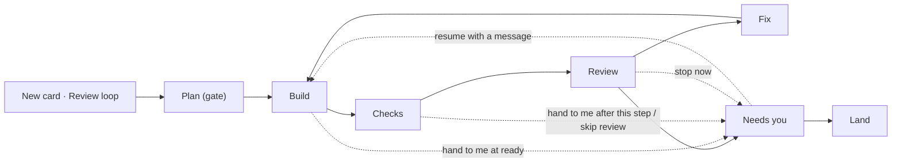

# Review loop: starting, stages and interventions

## Problem Statement

Starting a monitored card is awkward. The new-card dialog knows nothing about the review loop, so the only honest path is to create a card without a thread, open it, turn the Review loop switch on, pick gates, and then start the thread. Creating the card with "Start a thread now" and switching the loop on afterwards works, but the thread began under the plain contract (move the card yourself) and gets the loop's contract as a message mid-turn. Four steps across three surfaces for the mode I want almost every card to run in.

Once the loop runs, I can't tell at a glance where a card is or what comes next. The board card shows one chip in the loop's own jargon (`classifying`, `fixing · yours`, `stuck · cap`, `approve r2`) and the card panel one status sentence. Columns tell me little: Building holds planning, building and fixing; Checking holds checks, classify and review; Needs you holds plan approval, findings approval, every kind of stuck, clean and accepted. Nine Needs-you labels read as nine unrelated states.

While the loop runs, my only lever is the switch, which discards the loop. I can't tell the agent something without opening its thread, can't say "finish after this round and hand it to me", can't skip a review I don't want, can't stop a check or review that is clearly wasted, and after a step fails twice the loop is simply over. Turning the plan gate on mid-loop silently does nothing until the next rethink.

In the last 30 days the switch was clicked once and `m` pressed zero times: the loop is barely used, and the start flow is why.

## Solution

**One decision at creation.** The new-card dialog asks how the card runs: Card only, Thread, or Review loop. Choosing Review loop shows the three gates inline. With a project chosen, the default is Review loop with auto-accept on, so a title and a project are the only required input. One Create makes the card, sets the loop state and starts the thread, whose first instructions already carry the loop's contract. The same control replaces Start in the card panel's Thread row for a card that has no thread yet, and in the brain-dump proposals' accept step. The switch stays for a card whose thread already runs, relabeled as joining the loop from here.

**Two layers of visibility.** Columns say who holds the ball: Building is the agent's thread, Checking is the board's hidden threads, Needs you is me. A pipeline strip in the card panel says which step: Plan → Build → Checks → Review → Fix → Needs you → Land, with done, current, upcoming and skipped steps, the current step's commit, elapsed time and running thread, a pill per round saying what it did, and the last checks result. The board chip uses the strip's words. Needs-you reasons fold into three buckets: approve, review, stuck.

**Interventions with a pending directive.** From the card panel, at any point: steer the thread with a message; hand the card to me at the next ready, or after the step the board is running; skip the next review; stop the running step now; retry a failed step; resume from Needs you with a message. A pending instruction shows in the strip as a banner with undo until the loop consumes it. `m` opens a loop menu holding all of them, with plain keys for the three most common; loop off moves into the menu.

## User Stories

### Starting a card

1. As a developer, I want the new-card dialog to ask how the card runs (Card only, Thread, Review loop), so that starting a monitored card is one decision in one place.
2. As a developer, I want Review loop with auto-accept to be the default once I pick a project, so that a title and a project are all I have to enter.
3. As a developer, I want Card only to be the default when no project is chosen, so that the dialog never offers a thread it can't start.
4. As a developer, I want the gates shown inline when I choose Review loop, prefilled by the card's kind (plan approval for Jira cards), so that I can change them without opening the card afterwards.
5. As a developer, I want Create to make the card, set the loop state and start the thread in one go, so that the thread's first instructions carry the loop's contract and no mid-turn message is needed.
6. As a developer, I want the Create button to say "Create and start" when a thread will start, so that I know what the button does before pressing it.
7. As a developer, I want the same run-mode control in the card panel's Thread row for a card without a thread, so that a card made earlier can start into the loop in one step.
8. As a developer, I want the brain-dump proposals' accept step to offer the same run mode for the cards it creates, so that planned cards can start into the loop too.
9. As a developer, I want the loop switch on a card whose thread already runs to say it joins the loop from here, and that the thread gets the contract as a message, so that I know what turning it on mid-flight means.
10. As a developer, I want `bb kanban add` to accept the gates alongside `--monitor` and `--start-thread`, so that the CLI can do what the dialog does.
11. As a developer, I want the Monitor tags setting to keep working for cards created by agents and sources without flags, so that nothing I set up before breaks.

### Seeing where a card is

12. As a developer, I want the card panel to show the loop as a strip of steps (Plan, Build, Checks, Review, Fix, Needs you, Land) with done, current, upcoming and skipped states, so that I see the whole pipeline and where the card is in it.
13. As a developer, I want Plan drawn as skipped when the plan gate is off, so that the strip shows the path this card actually takes.
14. As a developer, I want the current step to show its commit, how long it has run, and a link to the thread running it, so that I can tell a slow step from a stuck one and watch it if I want.
15. As a developer, I want a pill per round under the strip saying what each round did (3 fixed, 1 disputed, reviewing, yours), with the cap visible, so that I see how the loop is converging.
16. As a developer, I want the last checks result on the strip (passed or failed, the command, exit code), so that I don't have to open the checks thread for it.
17. As a developer, I want Enter on a step to open what it produced (the plan, the checks output, the review's findings, the diff), so that each step is a hop from the strip.
18. As a developer, I want the board card's chip to use the strip's words (`build`, `checks`, `review 2`, `fix 2`, `plan?`, `needs you`, `stuck`), so that the board and the panel say the same thing.
19. As a developer, I want Needs-you reasons grouped into approve (plan, findings), review (clean at a level; handed off or stopped, as not reviewed) and stuck (checks, cap, not converging, dispute, loop error, question), with the detail as a second word, so that I read three buckets, not nine labels.
20. As a developer, I want the chip to show how long a card has waited for me once it passes an hour, so that neglected cards stand out.
21. As a developer, I want the Building, Checking and Needs you column headers to say who holds the ball (agent, board, you), so that the columns' meaning is stated rather than learned.
22. As a developer, I want a pending directive shown on the board card as a short suffix, so that I see from the board which cards are about to come to me.

### Intervening while the agent works

23. As a developer, I want a one-line composer in the card panel's loop section that sends a message to the card's thread, so that I can steer the agent without leaving the board.
24. As a developer, I want a steering message wrapped so the thread knows it is from me and that it should carry on and report ready as before, so that the agent does not read it as a new task that ends the loop.
25. As a developer, I want `i` to go to the composer while the loop runs, so that steering is one key away.
26. As a developer, I want "Hand to me at the next ready" while the agent builds or fixes, so that the next ready comes straight to Needs you with no checks and no review.
27. As a developer, I want "Skip review once" while the agent builds or fixes, so that the next ready runs the checks and then comes to me without a review round.
28. As a developer, I want a pending directive shown in the strip as a banner with undo, so that I see what I asked for and can take it back before the loop consumes it.
29. As a developer, I want only one directive pending at a time, with a new one replacing the old, so that the loop's next move is never ambiguous.

### Intervening while the board works

30. As a developer, I want "Hand to me after this step" while the board checks, classifies or reviews, so that the step finishes and its result is kept, but no fix round follows.
31. As a developer, I want "Stop now" while the board checks or reviews, so that the running hidden thread is stopped and the card comes to me at once.
32. As a developer, I want the brief after a hand-off or a stop to say what the board did and did not verify, so that I know how much to trust the change.
33. As a developer, I want Accept to stay available after a hand-off or a stop, so that I can take a change I chose to look at myself.

### Intervening at Needs you

34. As a developer, I want "Resume with a message" at Needs you, so that I can send the card back for another round with my own words, counted as mine.
35. As a developer, I want "Retry" at a loop error, so that a step that failed twice can run again at the same commit on my say-so.
36. As a developer, I want the number of manual retries shown, so that I notice a step that never succeeds.
37. As a developer, I want the existing brief actions (Accept, Send back, Rethink, Pull in, Uphold, Close, Reading plan, Change level, Approve) unchanged, so that nothing I know moves.

### Keys and menu

38. As a developer, I want `m` to open a loop menu listing every intervention with its key, so that rare actions are findable without memorising them.
39. As a developer, I want plain keys for steer (`s`), hand to me (`f`) and stop now (`x`), so that the common interventions are one keystroke.
40. As a developer, I want `f` to mean "at the next ready" while the agent works and "after this step" while the board works, so that one key does the right thing for the phase.
41. As a developer, I want loop off behind the menu rather than on a plain key, so that the one action that discards the loop is not the first thing a key reaches.
42. As a developer, I want the plan gate's row to say "takes effect at the next Rethink" when I turn it on mid-loop, so that the gate's delay is stated instead of silent.
43. As a developer, I want `?` to list the new keys, so that the shortcuts dialog stays complete.

### Notifications

44. As a developer, I want a hand-off or a stop to mark the card's thread unread and notify me the way other Needs-you stops do, so that the card reaches me.
45. As a developer, I want a steering turn that ends without a ready to show as unread, so that I see the agent's answer to what I said.

## Implementation Decisions

Decisions taken with the user on 2026-10-23: the default run mode is Review loop with auto-accept on; hand to me while the agent works means no checks and no review; steering happens from a composer in the card panel; a step that failed twice can be retried by hand.

- **Run mode is a UI concept.** The create RPC already takes the monitored flag and starts the thread after the card and its loop state exist, so a thread started at creation gets the builder contract from its first instructions. The create RPC gains optional gates. The dialog maps Card only, Thread and Review loop onto the existing flags; it adds no new server state. The card panel's Thread row and the proposals' accept step use the same control.
- **Defaults.** With a project: Review loop with the kind's default gates. Without a project: Card only, and the other modes are disabled with a note. Nothing is remembered between dialogs. The Monitor tags setting keeps deciding for cards created without an explicit flag.
- **Auto-accept is on in the kind defaults.** The shared default-gates function returns auto-accept on for every kind (plan approval stays on for Jira cards), so the dialog, `bb kanban add --monitor`, Monitor tags and `bb kanban monitor on` all monitor with the same gates. Cards already monitored keep the gates they have.
- **The strip is a pure function of loop state.** A shared function turns loop state and gates into the list of steps with their status, the current step's detail, and the round pills, the way the phase chip is computed today. The card panel renders it in place of the status sentence; the board chip and the chip's buckets come from the same function so the two surfaces can't disagree.
- **Time in step.** Loop state gains the time the current phase began. The reducer takes no clock, so the dispatch wrapper around it compares the phase before and after each event and stamps the time when it changed; the reducer and its tests stay clock-free. Stored state without it parses with null and shows no time.
- **Column subtitles** are keyed by column id (in-progress: agent, checking: board, review: you) and shown only on boards that have the loop's columns. Column ids and names stay as they are; migrations are append-only and columns are user-renamable, so renaming is out of scope.
- **Directives.** Loop state gains one optional directive: hand off at ready, hand off after the running step, or skip the next review. Reducer events set and clear it. The reducer consumes it:
  - *hand off at ready*: at the next ready, record the commit and evidence, don't spawn checks, go to Needs you with reason "handed off" and no attention level.
  - *hand off after step*: at the next checks result or review completion, keep the result (a passing check, or the review's findings listed as open) and go to Needs you with reason "handed off"; a failing check goes to Needs you with reason "checks" rather than back to the thread. Set while classifying, it waits for the review to complete, since classify is the review's first half and the checks have already passed.
  - *skip review once*: at the next ready run the checks; on a pass go to Needs you with reason "handed off" instead of classifying; on a failure bounce to the thread as today and keep the directive.
  - A directive is cleared when consumed, on undo, on rethink and on loop off. Setting one replaces any pending one.
- **Stop now** is a reducer event allowed in checking, classifying and reviewing. It issues the existing stop-superseded action to end the hidden thread, discards that step's result, and goes to Needs you with reason "stopped".
- **Retry** is a reducer event allowed at Needs you with reason loop error. It clears the reason, resets the automatic retry count, counts a manual retry, and re-issues the spawn action for the failed step at the same commit. Manual retries are unlimited and the count is shown in the strip and the brief.
- **Resume with a message** is a reducer event allowed at Needs you. It behaves as Send back does without comments: the phase returns to building, a round owned by the user is recorded, the card moves to Building, and the thread is prompted with the user's words under the same wrapper as steering, plus the builder contract.
- **Steer** is not a reducer event: an RPC sends the text to the card's thread wrapped as "the user says, from the board: …; this is steering, not a new task; carry on, and when the work is done commit, run the checks and report ready as before." It is allowed whenever the card has a thread and the loop is not accepted or landed. While the board runs a step, the menu notes that a ready from the steered thread supersedes the running step, as any ready does. While the thread is paused on a question, the ticket verifies whether a sent message answers bb's pending question; if it does not, the composer says to answer in the thread and offers to open it.
- **Needs-you buckets.** The reason enum gains "handed off" and "stopped". A shared function maps every reason to a bucket (approve, review, stuck) and a detail word; the chip, the strip and the brief header use it. Handed off and stopped are things the user asked for, so they sit in the review bucket with the detail "not reviewed" or "stopped", never in stuck.
- **Brief after a hand-off or stop.** The brief's first group says what ran and what did not (checks at commit X passed; no review; or review stopped), the level reads "not assessed" with Accept enabled and no reading plan, and the evidence group shows the agent's evidence alone.
- **Keys.** The card keymap gains `s` (steer: focus the composer), `f` (hand to me, phase-dependent) and `x` (stop now); `m` opens a loop menu (on the board, `m` on the focused card opens the same menu for it instead of toggling the switch) built on the bb-vim-keys menu pieces, listing steer, hand to me, skip review once, stop now, retry, resume with a message, gates, and loop off, each with its key where it has one, and disabled items greyed with the reason. The composer is the card's main input while the loop runs, so `i` reaches it; Escape leaves it. `S` stays Send back. The shortcuts help lists the new keys.
- **Notifications** go through the existing stop path: a hand-off or a stop publishes the loop-stopped event and marks the thread unread, as other Needs-you reasons do. A steering turn clears the handed-off mark when it starts, so if it ends idle without a ready the thread shows as unread, which is wanted.
- **CLI parity.** `bb kanban add` gains `--gates`. A `bb kanban loop <hand-off|skip-review|stop|retry|steer|resume>` command wraps the same RPCs for the user; the card's own agent is not told about it and the skill does not list it.
- **Plan gate caveat.** The gate row's hint changes to "takes effect at the next Rethink" when it is turned on while the loop is past planning. No change to the reducer's behaviour.

## Testing Decisions

A good test feeds a surface its inputs and checks what comes out: reducer events in, state and actions out; loop state in, strip steps out; a keymap in, conflicts out. No test reads component internals.

- **The loop reducer stays the main seam.** New cases: each directive set, replaced, undone and consumed in each phase it applies to; hand off at ready skipping checks and review; hand off after a passing check, a failing check and a completed review; skip review once with a pass and with a failure; stop now in checking and reviewing issuing the stop action; retry after a loop error re-spawning the step and counting; resume recording a user round and prompting; rethink and loop off clearing a directive; the phase-start time moving with the phase; the new reasons passing through the passive-idle and waiting predicates.
- **The strip function** is tested directly as a pure function, as the phase chip and the handoff brief are today: skipped Plan with the gate off, each phase's current step, round pills for loop and user rounds, a pending directive, and the bucket for every reason.
- **Keymaps.** The existing keymap tests cover conflicts and the shortcuts list; the loop menu's keymap is added to them.
- **Adapters** get one test each in the plugin's server test style with the fake host: a create call in Review loop mode spawns a thread whose instructions carry the builder contract; steer sends the wrapped text to the card's thread; retry re-spawns the checks thread.
- **Prior art:** the reducer tests, the handoff-brief and phase-chip tests, the keymap tests, and the server tests for card threads and the loop's adapters.

## Out of Scope

- Renaming or restructuring columns; the ids and names stay.
- Showing the strip on the thread page above the composer. Wanted, but it lives in a content script or the diff-view plugin and is its own feature.
- Remembering the last run mode per project.
- Automatic retries beyond the existing one.
- A directive queue; one pending directive at a time.
- Driving the loop from the card's own agent; the new CLI command is for the user.
- Subtask threads and the "start children" flows.

## Further Notes

- Usage in the 30 days before this spec: `m` pressed zero times, the loop switch clicked once. The keys were free to reassign, and the design is not constrained by habit.
- The mockup discussed with the user: a segmented "How it runs" control with inline gates in the dialog; in the card panel a strip of seven dots with Plan dashed, the current step haloed, an agent/board/you bar under it, a detail grid (now, rounds, checks), a pending-directive banner with undo, and a row of Steer, Hand to me, Stop now and Loop menu buttons with their keys.
- Build order, each step shippable: run mode in the dialog and panel; the strip, chip words and buckets; directives, stop and retry in the reducer with the menu and keys; steer and resume; CLI parity and the column subtitles.
