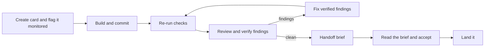

# Monitored review loop

## Problem Statement

The Kanban board can review a PR card and apply the findings, but every step needs me: I press Review, wait, read every finding, pick which to apply, press Apply, wait, press Review since, and repeat. I review the changes my own agents write, and I don't know when to stop. Findings are not checked before I see them, so I spend time on false positives. A finding the agent disagrees with comes back every round. Nothing tells me how hard to look at a change: a one-line copy fix and a change to token handling reach me the same way. Cards with no PR, which is most of my own agent work, can't be reviewed at all.

Following Anthropic's write-up on how the Claude Code team does code review, I want the board to catch as much as it can before I look:

- the checks are re-run independently;
- a fresh-context review runs, and every finding is verified;
- the card's own agent fixes what's real and answers every finding;
- the rounds are capped so the loop converges.

When I do look, I want to be told how deep to go and why. That should cost tokens only on the cards I choose, not on small throwaway tasks.

## Solution

A card can be flagged **monitored**. On a monitored card the board runs the loop itself:

1. **Build.** The card's thread implements the change, commits it, and reports ready with evidence of how it verified the work.
2. **Checks.** A fresh thread re-runs the project's check command at that commit. If it fails, the output goes back to the card's thread and no review tokens are spent.
3. **Classify.** A short, cheap pass over the change scores each file's risk. That sets an attention level, which picks the review depth.
4. **Review and verify.** The code-review skill reviews the change at that depth in a fresh context, and verifies every finding. Findings that don't hold up are filtered out. Findings in code the change didn't touch are tagged pre-existing. Code smells and nits are reported along with bugs. A scope check flags parts of the change that go beyond what the card asked for.
5. **Triage.** Each verified finding gets the same judgment apply-review uses today, made in the review step rather than by the author:
   - **apply:** it belongs in this change;
   - **defer:** it's real but out of scope, and becomes a follow-up card;
   - **drop:** the fix costs more churn than it's worth (a large rewrite for a small gain), or it conflicts with the project's conventions. Low priority alone is never a reason to drop.

   Every decision carries a reason.
6. **Route.** Every finding triaged apply, from bugs to nits and code smells, goes back to the card's thread in one fix prompt. It fixes exactly those, fixing each bug class in full and nothing beyond, and answers every finding: fixed or disputed with a reason. The board then re-checks and re-reviews only the delta, including whether the fixes stayed in scope. Deferred, dropped and pre-existing findings never enter the loop.
7. **Stop.** The loop ends clean, or it escalates to me:
   - after 3 automatic rounds;
   - when a fix doesn't hold;
   - when the checks fail twice;
   - when the verifier rejects a dispute on a critical or important finding;
   - when a thread fails twice;
   - when the card's thread asks a question.
8. **Hand off.** A one-screen brief shows:
   - the attention level (Glance, Read or Scrutinize) and the reasons for it;
   - what the checks don't cover;
   - evidence, with the checks the board re-ran kept apart from what the agent only claims;
   - the history of each round;
   - a reading plan matched to the level.

   I Accept, Send back, or Rethink. At Scrutinize, Accept stays disabled until I've marked the plan's files viewed.

Three optional gates are chosen when a card is monitored:

- approve the plan before building;
- approve findings before each fix round;
- auto-accept a change that ends at Glance level.

Unmonitored cards keep today's manual Review and Apply buttons on the same machinery.

Happy path:

## User Stories

### Monitoring a card

1. As a developer, I want to flag a card as monitored from the card panel, so that the board runs the review loop on it without me pressing buttons.
2. As a developer, I want to flag a card as monitored from the keyboard, so that the flag has a keyboard path like every other card action.
3. As an agent, I want `bb kanban monitor on|off`, so that a card I create for a larger task can opt in.
4. As a developer, I want a source or tag to make new cards monitored by default, so that Jira tickets or a project's work opt in without my flipping each one.
5. As a developer, I want a card's own flag to override any default, so that I can opt a throwaway task out even when its source monitors by default.
6. As a developer, I want monitored cards marked on the board, so that I can see which cards are spending tokens on their own.
7. As a developer, I want to choose the plan, findings and auto-accept gates when I monitor a card, so that I can trade attention for spend per task.
8. As a developer, I want sensible defaults for those gates, so that monitoring a card takes one keystroke in the common case. The defaults are: plan approval on for Jira cards and off for ad hoc cards, findings approval off, and auto-accept off.
9. As a developer, I want to turn monitoring off partway through, so that I can take a card over by hand. The loop stops after the current step, and the manual buttons come back.
10. As a developer, I want unmonitored cards to work exactly as they do today, so that small tasks cost nothing extra.

### Building and evidence

11. As a developer, I want a monitored card's thread told to commit its work and report ready with evidence, so that the loop starts from a known commit.
12. As a developer, I want the card's thread told never to move the card to Done itself, so that only the loop or I finish a monitored card.
13. As a developer, I want evidence recorded as the commands the agent ran, their exit codes and the tail of their output, plus screenshots for UI changes, so that I can see how the work was verified.
14. As a developer, I want a per-project check command setting, so that the board re-runs the same checks every time.
15. As a developer, I want the agent to name the check command when the project has none set, and the brief to say the agent chose it, so that projects without a setting still work and I know the command was its choice.
16. As a developer, I want the plan approval gate, when on, to stop the card's thread after it proposes a plan and wait for my approval or edits, so that I decide direction before any code is written.

### Checks

17. As a developer, I want the board to re-run the check command in a fresh thread at the reported commit, so that evidence doesn't rest on the agent's word.
18. As a developer, I want failing checks sent back to the card's thread with their output, without running a review, so that no review tokens go to code that doesn't build.
19. As a developer, I want the loop to escalate after the checks fail twice in a row, so that a card that can't get green stops spending.
20. As a developer, I want the brief to show which checks the board re-ran and which the agent only claims, so that I know which evidence to trust.

### Classify, review and verify

21. As a developer, I want a cheap classify pass at the start of the first round, giving each changed file a risk and a role, so that the attention level and review depth come from the change itself without paying for a full narrative.
22. As a developer, I want the review depth taken from the attention level, so that tokens are spent where the risk is. Glance gets Quick, Read gets Standard, and Scrutinize gets Deep, which adds a security review.
23. As a developer, I want path rules per project that raise the attention level, so that areas I know are risky always get a deeper look. Examples are auth, billing, CI workflows and installers.
24. As a developer, I want every finding verified by a separate agent and scored 0–100 for whether it's real, with findings below 80 filtered out, so that false positives don't reach the loop or me while real nits still do.
25. As a developer, I want filtered findings kept and shown collapsed as "N filtered", so that I can check the filter when I want to.
26. As a developer, I want findings in code the change didn't touch tagged pre-existing and kept out of the loop, so that the agent isn't asked to fix old bugs and I'm not blamed for them.
27. As a developer, I want a make-a-card action on pre-existing findings, so that old bugs become backlog work instead of being lost.
28. As a developer, I want each finding to name its bug class and every instance, so that one fix covers all of them.
29. As a developer, I want nits and code smells reported and fixed when they're in scope, so that changes land clean, not just correct.
30. As a developer, I want the final review to list what the checks don't cover, so that I know where my attention is actually needed. That means untested paths, behavior only visible in the UI, and anything it couldn't verify.

### Scope

31. As a developer, I want the review to compare the change against what the card asked for, so that I learn when a change grows beyond its card. The comparison uses the card's title, description, approved plan and spec when there is one.
32. As a developer, I want scope findings that name the hunks beyond the card's intent and recommend splitting them out, so that the fix for scope creep is to remove the extra work, not to polish it.
33. As a developer, I want every verified finding triaged apply, defer or drop with a reason, using the criteria apply-review uses today, so that the loop applies what belongs in this change rather than everything it found.
34. As a developer, I want triage done in the review step, not by the card's thread, so that the author doesn't get to decide which of its own findings are worth fixing.
35. As a developer, I want a finding whose proper fix needs a new feature, abstraction or refactor beyond the change deferred, even when it's critical, so that the change stays well scoped. If it's critical, it should also raise the attention level, so that I decide whether the change can land without it.
36. As a developer, I want deferred findings listed with a make-a-card action, so that out-of-scope work becomes follow-ups instead of being lost.
37. As a developer, I want dropped findings listed collapsed with their reasons, so that I can check triage's judgment.
38. As a developer, I want to pull a deferred or dropped finding back in, which starts a round I own, so that I can overrule triage.
39. As a developer, I want each fix prompt to tell the card's thread to fix exactly the listed findings, covering each bug class in full and nothing more, so that fix rounds don't grow the change.
40. As a developer, I want the delta re-review to flag fix commits that go beyond the findings they answer, so that scope drift during fixing is caught like any other finding.
41. As a developer, I want the brief to list scope findings and deferred work, so that I see how much the change grew and what it left for later.

### Fix rounds

42. As a developer, I want every finding triaged apply fixed in the loop, whatever its severity, so that in-scope nits and code smells get cleaned up, not just correctness bugs.
43. As a developer, I want all of a round's apply findings fixed together in one fix prompt, so that nits add no extra rounds alongside bigger fixes.
44. As a developer, I want findings sent to the card's own thread rather than a separate apply thread, so that the author fixes its own change on one branch, and the review stays the only fresh context.
45. As a developer, I want the card's thread to answer every finding it was given, either fixed or disputed with a reason, so that no finding is silently skipped.
46. As a developer, I want the next round to re-check each disputed finding against the agent's reason, so that a dispute can close a finding without me.
47. As a developer, I want a disputed finding the verifier accepts closed as "disputed, accepted", so that I can see it was argued and settled.
48. As a developer, I want a disputed finding the verifier rejects escalated to me rather than sent back, so that the agent and the reviewer don't argue in a loop.
49. As a developer, I want each re-review to cover only the new commits and never repeat a finding already answered, so that later rounds are cheap and don't churn.
50. As a developer, I want the loop to escalate when a finding the agent reported fixed is still there, so that non-convergence stops early instead of using all three rounds.
51. As a developer, I want the loop capped at three automatic rounds, after which I'm asked to rethink the approach, so that a bad approach can't spend all night.
52. As a developer, I want the findings approval gate, when on, to show me each round's findings to approve or deselect before the fix runs, so that I can control spend and scope on sensitive work.
53. As a developer, I want fix rounds on my own PR cards to push to the PR branch, and fix rounds on local cards to commit in the card's environment, so that the change under review is always where the next round looks.

### Pauses and failures

54. As a developer, I want the loop paused while the card's thread waits on a question, and the card shown as needing me straight away, so that a blocked agent gets my attention right away.
55. As a developer, I want a failed review or checks thread retried once and then escalated as a loop error, so that a broken setup doesn't fail silently or retry forever.
56. As a developer, I want the reason every escalation happened shown on the card, so that I know what's needed before I open anything. The reasons are: cap reached, not converging, checks failing, dispute, question, or loop error.

### Board surface

57. As a developer, I want a Checking column the loop owns, between Building and Needs you, so that I can see which cards are in progress without me.
58. As a developer, I want the In Progress and In Review columns renamed Building and Needs you by default, keeping their ids, so that the board reads as the loop without breaking agents that move cards by id.
59. As a developer, I want a phase chip on each monitored card, so that I can read the loop's state at a glance. The phases are: checks, classifying, review rN, fixing rN, stuck, ready · level.
60. As a developer, I want round pips on each monitored card, so that I can see how many rounds it took.
61. As a developer, I want Needs you sorted by attention level and then by age, so that I handle Scrutinize work deliberately and clear Glance work quickly.
62. As a developer, I want a notification when a card reaches Needs you, if bb's plugin API can send one, so that I don't have to watch the board.
63. As a developer, I want each card to show the tokens used across every thread it started, so that I can see what monitoring costs.
64. As a developer, I want every loop thread hidden from the sidebar the way review threads are today, so that the loop doesn't clutter my thread list.

### The handoff brief

65. As a developer, I want a brief at the top of the card panel when a monitored card reaches Needs you, so that everything I need to decide is on one screen.
66. As a developer, I want the brief to lead with the attention level and its listed reasons, so that I know how hard to look and why. Example reasons are "token handling in the GitHub client", "took 3 rounds", "1 disputed finding", and "UI change, no headless test".
67. As a developer, I want "what the checks don't cover" right after the level, so that the gaps in verification are the first thing I read.
68. As a developer, I want the evidence section to separate checks the board re-ran from what the agent only claims, so that I know which evidence to trust.
69. As a developer, I want the loop history in the brief, so that I can see how the change got here. That means each round's resolved findings, accepted disputes and the round count.
70. As a developer, I want the disputes awaiting me listed with both sides' reasoning and a choice to uphold or close each, so that I can settle them quickly.
71. As a developer, I want the brief to list the nits and smells the loop fixed, so that I can see the polish that went in.
72. As a developer, I want a reading plan that opens the narrative stepper filtered by level, so that I read the right amount:
    - Glance: the evidence and the not-covered list only;
    - Read: the key files;
    - Scrutinize: the key and supporting files;
    - mechanical files: always collapsed.
73. As a developer, I want Accept disabled at Scrutinize until the plan's files are marked viewed, so that I can't skim a high-risk change by accident.
74. As a developer, I want to change the attention level with a reason, so that I can correct the classifier. The reason is kept as a signal for later tuning.
75. As a developer, I want the same brief as a strip at the top of the changes view, so that the level and reading plan stay with me while I read the diff.
76. As a developer, I want Accept on a local card to tell the card's thread to land the change using the project's finishing steps, so that landing is one action.
77. As a developer, I want Accept on a PR card to end the loop and mark the card accepted, with merging left to me on GitHub, so that nothing outward-facing happens without me.
78. As a developer, I want Send back to pass my diff comments to the card's thread as a round I started, which doesn't count toward the cap, so that my feedback goes through the same loop.
79. As a developer, I want Rethink to stop the loop and ask the card's thread to reconsider its approach and propose a new one, so that a change heading the wrong way is reshaped, not patched.
80. As a developer, I want the auto-accept gate, when on, to accept a card at Glance level with no open critical or important findings, without stopping at Needs you, so that trivial monitored work doesn't wait on me.
81. As a developer, I want open minor findings not to block auto-accept, and to be listed on the accepted card with a make-a-card action, so that a leftover nit doesn't hold up trivial work or get lost. These are minors still open at the cap, or minor disputes the verifier rejected.
82. As a developer, I want auto-accept never to apply at Read or Scrutinize, so that a risky change always stops for me.
83. As a developer, I want every brief action reachable by keyboard with vim-style movement, so that the handoff follows the board's keyboard-first rules.

### Unmonitored cards and PR cards

84. As a developer, I want Review available on any card that has a branch, not only PR cards, so that my unmonitored local work can be reviewed by hand too.
85. As a developer, I want verification, pre-existing tagging and bug classes on manual reviews too, so that unmonitored reviews are just as low-noise.
86. As a developer, I want the default selection on a manual review to be the findings triaged apply, so that I rarely need to pick findings by hand and the default keeps the change scoped.
87. As a developer, I want apply-review's interactive triage to use the same written criteria as the review's triage, so that my manual triage and the loop's judge scope the same way.

## Implementation Decisions

- **One pipeline, two drivers.** Monitored cards are driven by the loop. Unmonitored cards are driven by today's buttons and CLI. Reviews, verification, tours and fix prompts share one implementation.
- **The loop is a pure reducer.** A module takes the card's loop state and an event, and returns the new state plus a list of actions. It has no I/O.
  - Events: ready (commit, evidence, check command), checks result (pass or fail, exit code, output tail), tour completed (per-file risk and roles), review completed (report), fix round completed (commit and a response per finding), question asked, thread failed, and my actions (accept, send back, rethink, approve plan, approve findings, uphold or close a dispute, change level, unmonitor).
  - Actions: spawn a checks thread, spawn a tour, spawn a review at a depth, prompt the card's thread with fix, land, rethink or plan-approved content, move the card to a column, notify, set the escalation reason.
  - The plugin's thread lifecycle handlers, CLI commands and RPCs are thin adapters. They turn bb thread events, CLI calls and UI actions into reducer events, and carry out the actions.
- **Loop state per card** is stored with the card:
  - the monitored flag and its gate options;
  - phase, round number, human round count and escalation reason;
  - the commit being checked or reviewed;
  - the checks history;
  - the attention level, its reasons, and any level I set myself, with my reason;
  - the current findings' state and open disputes.
- **Phases:** idle, planning (when the plan gate is on), building, checking, classifying, reviewing, fixing, paused (question), needs-you (with reason: clean, cap, not converging, checks, dispute, loop error), accepted, landed.
- **Columns:** a new `checking` column id. The defaults rename `in-progress` to "Building" and `review` to "Needs you", keeping both ids. The loop moves cards between building, checking and review. The existing move-to-In-Progress-on-activity still applies to unmonitored cards.
- **Existing boards.** Columns are stored per board, so changing the defaults only affects new boards. When a card is first monitored, any column id the loop needs that the board lacks is added: `checking` goes just before `review`, and a missing `in-progress` or `review` is restored where it belongs. The renames are display-only and are not applied to an existing board.
- **Builder contract.** A monitored card's thread gets role instructions:
  - commit its work;
  - run the check command;
  - finish with a new `bb kanban ready` command that takes the commit, the evidence and, when the project sets none, the check command;
  - never move the card itself;
  - after a fix prompt, fix exactly the listed findings, covering each bug class in full but adding no refactors, features or clean-ups beyond them;
  - answer every finding with a new response command (fixed, or disputed with a reason), then report ready again.

  The plan gate adds "propose a plan and wait." These go through the existing per-role instruction map, and prompts reach the existing card thread through the existing card-thread prompting.
- **Checks thread.** A short hidden thread checks out the reported commit detached in a fresh worktree of the card's project and runs the check command. It reports the exit code and output tail through a new record command. The commit is visible there because worktrees of one project share the repository. For PR cards it uses today's fetch steps.
- **Reviews for every card with a branch.** Review and apply no longer require a PR. For a local card, the review diffs the reported commit against its merge base with the project's default branch, in a fresh worktree checked out at that commit. PR cards keep today's PR fetch. The PR-only guards in review spawning and the review and apply prompts become per-kind branches.
- **Classify is its own cheap pass.** The narrative review that replaced the tour is too slow and costly to run before every first review. Instead a short hidden thread scores each changed file's risk (1–5) and role (key, supporting, mechanical) and its lines changed, and hands them back as a small `kanban-classify` JSON block the board parses, separate from the tour's schema. It runs once at the start of round 1, and goes through the same retry-once path as the checks and review threads; a second failure reviews at Standard rather than stopping the loop. The narrative is requested only at handoff, when the card reaches Needs you at Read or Scrutinize, and the brief works without it.
- **Reading plan is the narrative stepper.** The narrative code review, built in a separate thread, extends the tour with exhaustive steps whose file refs carry path, side and line range. The brief opens that stepper filtered by level instead of drawing a plan of its own. Per-file role and risk stay on the tour's reading order. The Scrutinize gate reads the changes view's per-file Viewed marks, which the stepper offers to set once every step touching a file has been visited. The loop never changes the tour's prompt or schema.
- **Attention level** is computed by a pure function from:
  - the highest per-file risk from the classify pass;
  - per-project path rules;
  - loop signals: rounds used, accepted or open disputes, check failures, and whether "not covered" is non-empty;
  - scope signals: open scope findings, and deferred critical findings;
  - diff size.

  It returns Glance, Read or Scrutinize plus human-readable reasons. A level I set overrides it until the head moves.
- **Per-project settings** in the plugin: the check command, and path rules (glob → minimum level).
- **Review depth.** The loop passes Quick, Standard or Deep to the code-review skill: Glance → Quick, Read → Standard, Scrutinize → Deep. Deep adds a security review.
- **Changes to the code-review skill.** Its output format stays the same: the markdown sections and the trailing review-findings JSON block. Changes:
  - **Depth:** a depth argument that picks which finders run, not just how many.
    - Quick: correctness, CLAUDE.md compliance, scope, and style (including code smells).
    - Standard: adds testing and git history.
    - Deep: adds security, through the security reviewer and `/security-review`.
    - The storage reviewer runs only when storage files change.
    - A manual review without a depth runs Standard.
  - **Finders:** new git-history and CLAUDE.md-compliance finders, adapted from Anthropic's official code-review plugin.
  - **Verify:** a verify pass that scores every finding 0–100 for whether it's real and introduced by the change, adapted from that plugin's rubric. Unlike that rubric, a real nit scores as high as a real bug: severity is recorded separately and doesn't lower confidence. Findings below 80 move to a filtered list rather than being deleted.
  - **Pre-existing:** tagging based on whether the finding's lines are in the diff.
  - **Bug class:** a name for each finding's bug class, alongside its existing list of locations.
  - **Scope finder:** runs at every depth. It's given the card's intent (title, description, approved plan, and the spec when one exists) and reports hunks beyond it, under a new `scope` category. Its recommended fix is to remove or split out the extra work. On a delta re-review it also checks that each fix commit stays within the findings it answers.
  - **Triage step**, after verify:
    - every verified, introduced finding gets a decision (apply, defer or drop) and a reason;
    - it uses the judgment apply-review's triage uses today: wrong scope, churn out of proportion to the benefit, and conflicts with project conventions (the verifier already covers false positives and speculation). Low priority alone is never a reason to drop, so in-scope nits and code smells are applied;
    - the importance and scope-fit scores (1–5) stay as triage inputs, and low scope fit is the main signal for defer;
    - a critical finding can still be deferred when its proper fix is a separate piece of work.
  - **Shared criteria:** the triage criteria live in one written reference that both the code-review skill's triage step and apply-review's interactive triage read, so the two can't drift apart.
  - **Style:** style and code-smell findings are kept in loop and manual reviews, as minor.
  - **Not covered:** a new list of what the checks don't cover.
  - **Disputes:** the incremental re-check takes each earlier finding's response (fixed, or disputed with a reason) and classifies it as addressed, open, disputed-accepted or disputed-rejected.
- **Report schema additions:**
  - per finding: confidence (0–100), pre-existing, bug class, and triage (decision and reason);
  - per report: filtered findings, not-covered list, depth, and dispute outcomes.

  Importance and scope fit are still produced, as triage inputs.
- **Default selection** for manual applies becomes the findings triaged apply. This replaces the importance/scope heuristic. Old reviews without triage keep the heuristic.
- **Routing**, decided in the reducer:
  - **Start a fix round:** in the first round, any finding triaged apply, whatever its severity. After it, only a critical or important finding starts a round, and the open minors go with it; a re-review left with only minors ends the loop as if clean, with the minors listed, as does reaching the cap with only minors open. All of a round's findings go in one fix prompt.
  - **Polish rounds:** a round whose findings are all minor is checked but not re-reviewed; the loop ends clean once its checks pass, with the minors the thread disputed listed as open.
  - **Size:** ordinary logic (risk 3) under 100 changed lines is Glance, so it gets a Quick review; a check failure under a command the thread then replaced doesn't count toward the level.
  - **Severity floor:** the re-reviews after the first round ask the code-review skill for critical and important findings only, skipping the style finder, since a new minor can't start a round there.
  - **Deferred findings:** listed with make-a-card, never routed. A deferred critical finding raises the attention level to at least Read.
  - **Dropped findings:** listed collapsed with their reasons, never routed.
  - **Pulling one back in:** pulling a deferred or dropped finding back in starts a round I own, which doesn't count toward the cap.
  - **Pre-existing findings:** listed, never routed.
  - **Disputes the verifier rejects:** on a critical or important finding they go to Needs you. On a minor finding they stay open as a minor and don't escalate.
  - **Not converging:** a critical or important finding the agent marked fixed but still open sends the card to Needs you. A minor one stays listed as open and isn't handed back.
- **Cap.** Three automatic rounds. Rounds I start with Send back, or by pulling a finding back in, are counted apart and never trip the cap.
- **Failures.** A checks, tour or review thread that goes idle without a record or report is retried once, then escalates as a loop error. A thread that finished with a final message the board can't parse escalates at once, with what went wrong, since a retry writes the same message; a review thread missing the code-review skill ends with a fixed line saying so. A review thread idling on an interim message (its verifiers still running, unseen by bb's background-agent count) isn't a failure until it has stayed idle ten minutes without a report. The existing idle handling, which waits for background agents, decides when a thread has really finished.
- **Worker threads.** Checks, classify, review and narrative threads are owned by the card's thread (archived and deleted with it) and run its provider and model, but are not its children, since bb posts a child's final message into its parent and the card's thread would act on it. A ready at a new commit while an older one is checked, classified or reviewed stops those threads; a repeated ready of the same commit is ignored. A narrative is only requested when the loop stops for the user to read the change, not for failing checks or a loop error.
- **Pause.** When the card's thread is waiting on me (bb's needs-input state), the loop pauses. The card shows needs-you with reason "question" without leaving its column, and the loop resumes on the next ready.
- **Accept.**
  - **Local cards:** the card's thread is prompted to land the change using the project's own finishing steps, and the card moves to Done when that thread reports landed.
  - **PR cards:** the loop ends as accepted and the card stays put. Sync moves it to Done on merge, as it does today.
- **Auto-accept** is allowed at Glance level when no critical or important finding and no escalated dispute is open. Open minor findings don't block it. They're listed on the accepted card with make-a-card, and the brief shows them when a person accepts.
- **Token spend per card.** The tokens used by every thread the card started (card, checks, tour, review) are summed from the provider transcripts, the way the dashboard plugin reads them. The total is shown on the card and in the brief.
- **Notification** when a card reaches Needs you, if bb's plugin API offers one. Otherwise the board badge and the column are the signal.
- **Keyboard.** The monitor toggle, every brief action, dispute decisions, the gate options and changing the level all get keys, using bb-vim-keys like the rest of the board. The actual keys are chosen in the tickets.

## Testing Decisions

- **One seam: the loop reducer.** Tests feed it event sequences and check the resulting state and actions. They test behavior, not internals:
  - the happy path to clean;
  - failing checks bouncing back, and escalating on the second failure;
  - a fix round followed by a clean re-review;
  - the cap at three rounds;
  - a serious finding marked fixed that's still open, escalating early, and a minor one left open;
  - disputes accepted and rejected;
  - nits and smells triaged apply starting the first round like any other finding, and only riding along with a serious finding after it;
  - deferred and dropped findings never routed;
  - a deferred critical finding raising the level;
  - pulling a finding back in starting a round I own;
  - pre-existing findings never routed;
  - each gate on and off;
  - auto-accept only at Glance, and open minors not blocking it;
  - the cap reached with only minors open ending the loop without escalating;
  - human rounds not counting toward the cap;
  - pause on a question and resume;
  - a thread failure retried once, then a loop error, and an unparseable result escalating without a retry;
  - a newer ready stopping the threads on the older commit;
  - unmonitoring partway through.
- **The attention-level function** is tested through the reducer's outputs, or directly as a pure function with the same inputs. Tests cover path rules raising the level, loop signals raising it, a level I set winning until the head moves, and the reasons listed.
- **Adapters** get a few integration tests in the plugin's existing server test style, using the bb plugin SDK's fake host:
  - a monitored card's ready command spawns a hidden checks thread;
  - a checks record leads to a tour, then a review;
  - a review report leads to a prompt into the card's thread;
  - Accept on a local card prompts landing.
- **Report parsing** gets cases for the new fields in the existing report-parsing tests, including old reports without them.
- **The code-review skill** has no automated tests here. It's checked by running it on a known change and confirming the report parses with the new fields.
- **Prior art:** the plugin's server tests for review spawning, thread lifecycle and report parsing, and its default-selection tests.

## Out of Scope

- Small, reversible changes: feature flags, staged rollout and rollback steps.
- Others' PRs (review requests). The monitored loop is for work I or my agents author. Turning verified findings into GitHub draft comments on others' PRs is a separate piece of work.
- Wrapping or calling Anthropic's official code-review plugin. Its verifier rubric and finders are adapted into my skill instead.
- Turning misses into fixes: dismissal reasons, a Teach action, and an eval set of past bugs to re-score the reviewer. Dispute outcomes and level overrides are recorded so this can build on them later.
- Automatically posting to, approving or merging on GitHub.
- A spend budget that stops a card by token count. Spend is shown, not enforced.

## Further Notes

- Background: Anthropic's "How the Claude Code team does code review" (claude.dev, 2026-10-15). The relevant ideas are:
  - verify before anyone looks;
  - check each finding in fresh agents before reporting it;
  - tag pre-existing findings;
  - every finding gets an answer;
  - cap the rounds and re-review only the diff;
  - flag the bug class;
  - set risk by the change, not the author;
  - say what the checks would miss.
- The skills this touches live outside the repo, in `~/.claude/skills/code-review` and `~/.claude/skills/apply-review`. They change alongside the plugin, and the output format the board parses must stay compatible with reviews already stored.
- A suggested build order, each step shippable on its own:
  1. the skill's verify, scope finder, triage, pre-existing tagging, bug classes and not-covered list, plus the report schema and board filtering;
  2. reviews for every card with a branch;
  3. the reducer, checks thread, builder contract and fix rounds with the cap and disputes;
  4. the attention level, the brief and the column changes;
  5. the gates, auto-accept, the notification and token spend.
